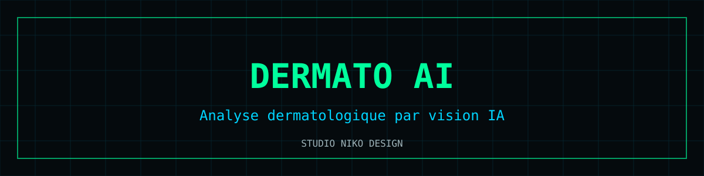
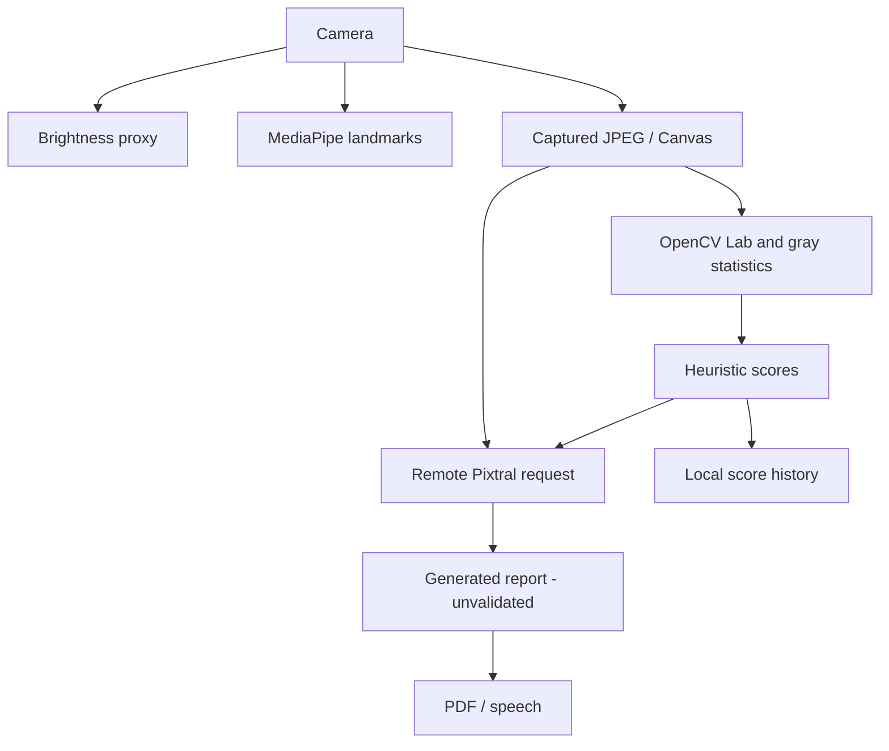

# Dermato AI — DERMA X-PRO V14.9 · Studio Niko Design

**Experimental camera-based skin image processing with OpenCV, MediaPipe and a remote vision-model report.**

Explorer la photographie numérique et le calcul de caractéristiques visuelles dans le navigateur, en distinguant descripteurs d'image, mesures physiques et texte généré. Aucun diagnostic dermatologique ni conseil thérapeutique validé.

    

**STUDIO NIKO DESIGN** · Build smart. Stay lightweight. Create without limits.

[English overview](#english-overview) · [Quickstart](#quickstart--démarrage-rapide) · [Portfolio](https://github.com/Nikoju1977)

> [Insérer ici un GIF de démonstration avec données synthétiques / Insert synthetic-data demo GIF here]

> **Prototype non validé cliniquement.** Ne pas utiliser pour un diagnostic, une prescription, un triage, une décision de traitement ou une urgence. En France, danger immédiat : 15 ou 112. Inspection statique uniquement ; aucun nouveau test d'exécution, audit de sécurité, test fournisseur, benchmark, validation clinique ou vérification de déploiement n'a été effectué.

## Fonctionnalités clés

- Acquisition caméra et indicateur de luminosité calculé sur une image réduite.
- Face Mesh pour visualiser des repères faciaux ; traitement OpenCV.js des pixels RGB/CIELAB et niveaux de gris.
- Indicateurs expérimentaux ITA, luminosité, texture et homogénéité ; historique local des scores (15 entrées maximum).
- Requête Pixtral distante avec image JPEG et scores, rapport généré en streaming et lecture vocale.
- Export PDF via jsPDF ; dépendances externes requises.

## Architecture & algorithmes

| Fonction | Constat statique |
| --- | --- |
| `initPhotometry` | Moyenne RGB d'un canvas 64 × 64, non une mesure d'éclairement en lux. |
| `initFaceMesh` | Repères du visage via MediaPipe, non segmentation dermatologique validée. |
| `computeBio` | Conversion CIELAB, moyenne L et b, angle ITA par atan2 ; dispersion de L et du gris transformée en scores bornés. Le calcul porte sur la capture, pas sur une région de peau calibrée. |
| `callMistral` | Un seul appel `pixtral-12b-2409` demande un rapport à deux voix. Les rôles ne constituent pas des agents indépendants. |

**Risques cliniques :** en cas d'absence d'OpenCV ou d'erreur, `computeBio` renvoie des valeurs fixes présentées comme scores. Ces valeurs ne sont pas des observations réelles. L'éclairage, le fond, la caméra, les couleurs et la zone capturée influencent les résultats. Aucun indicateur ne mesure une maladie, une hydratation ou une qualité biologique validée. Ne pas interpréter le rapport ou la routine comme une prescription ; un examen clinique reste nécessaire.

## Confidentialité et sécurité

- La clé `derma_key_v14` et l'historique des scores sont enregistrés via une façade `localStorage` avec repli mémoire, sans chiffrement applicatif.
- L'image JPEG et les métriques sont transmises à l'API Mistral au lancement du scan. Le dépôt ne démontre pas la politique de conservation du fournisseur ; aucune promesse de « zéro stockage serveur » ne peut être faite.
- Le rapport généré est injecté dans le DOM sous forme HTML via `innerHTML`, sans assainissement robuste établi dans ce chemin. Les consignes au modèle ne remplacent pas un contrôle de sécurité du rendu. Priorité : affichage texte ou assainissement strict et revue XSS.
- OpenCV.js 4.5.4, MediaPipe Face Mesh, Chart.js, jsPDF 2.5.1 et ressources externes nécessitent une revue de chaîne d'approvisionnement. Certaines versions CDN ne sont pas épinglées. La disponibilité du modèle, le fonctionnement PWA et le traitement vocal local ne sont pas vérifiés.
- Ne pas saisir de clé réelle ni filmer une personne pour les essais publics. L'import d'image en dehors du chemin caméra et l'installation PWA ne sont pas établis dans les sources inspectées.

## Référentiels et limites

DICOM (pour l'imagerie concernée), ISO 13485 (qualité), IEC 62304 (cycle de vie logiciel), ISO 14971 (risques), RGPD (données personnelles) et FDA 21 CFR Part 11 (enregistrements électroniques réglementés) sont des pistes de qualification selon l'usage prévu et le cadre applicable. Aucun certificat, marquage CE, autorisation réglementaire, audit indépendant ou conformité à ces référentiels n'est revendiqué. Les licences logicielles ne constituent pas une autorisation d'usage clinique. Une revue par des professionnels qualifiés est indispensable avant tout usage médical.

## Quickstart / Démarrage rapide

Servir la racine avec `python3 -m http.server 8000`, ouvrir http://localhost:8000/. Examiner l'interface sans données personnelles ni clé réelle. Les permissions caméra nécessitent un contexte sécurisé. Ne pas lancer une analyse distante de peau réelle.

## Roadmap & contribution

Propositions non terminées :

- [ ] Remplacer les scores de secours par un état indisponible explicite et supprimer les interprétations cliniques non validées.
- [ ] Sécuriser le rendu des sorties génératives et protéger les clés API.
- [ ] Tester les indicateurs sur images synthétiques avec éclairage, couleur et région d'intérêt contrôlés.
- [ ] Auditer les flux, les permissions caméra, la chaîne CDN et les exports.

**Première contribution / `good first issue` (label proposé, non créé ici) :** Ajouter un test synthétique vérifiant qu'une erreur OpenCV ne produit jamais de score présenté comme mesuré.

Les contributions sous MIT sont bienvenues. [Issues](https://github.com/Nikoju1977/dermato-ai/issues) pour les anomalies non sensibles. Ne jamais publier de données médicales, images identifiantes, secrets ou détails exploitables de vulnérabilité ; contacter le mainteneur en privé pour les signalements sensibles.

## English overview

DERMA X-PRO V14.9 combines camera image statistics, MediaPipe landmarks and OpenCV Lab/grayscale processing with one remote Pixtral request. The purported multi-agent report uses two roles in a single response. Fixed fallback scores can look like observations despite errors. The brightness proxy is not calibrated lux, and skin scores are not clinical measurements. API credentials and score history are unencrypted; images and scores go to Mistral. Generated HTML rendering requires a security review. Use synthetic data only.

No new runtime, provider, security or clinical validation was performed for this documentation revision.

## Licence & auteur / License & author

[MIT](LICENSE) © 2026 Nicolas Julienne — Studio Niko Design. Contributions sous MIT pour le code couvert ; les dépendances et composants tiers conservent leurs licences et crédits. Aucun fichier de licence n'a été modifié.

[Studio Niko Design](https://github.com/Nikoju1977)
